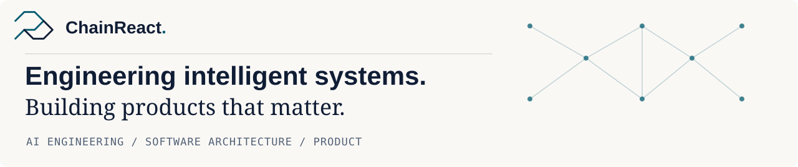

  <picture>
    <source media="(prefers-color-scheme: dark)" srcset="./assets/banner-dark.svg">
    
  </picture>
  <h1>Senior Software Engineer &amp; Tech Lead</h1>
  
Software Architecture · AI Engineering · Agentic Development

  
<a href="https://chainreactdev-ai.github.io/"><strong>Professional website · Site professionnel</strong></a>

I design and build reliable software systems, combining technical leadership, software architecture and applied AI.

My focus is on maintainable applications, intelligent automation and AI-driven engineering practices that deliver practical business value.

## Core expertise

**Software Architecture & Engineering** — Scalable backend services, modern web applications and maintainable architectures.

**AI Engineering & Agentic Systems** — Generative AI, agent orchestration, AWS AI services and intelligent automation.

**Agentic Software Development** — AI-powered development workflows, coding agents, automated testing and engineering quality.

## Technology focus

| Area | Focus |
| --- | --- |
| Backend | Node.js · Python |
| Frontend | React · Next.js |
| Cloud & AI | AWS Bedrock · Agentic Frameworks |
| Agentic development | Codex · Claude Code |

## Engineering principles

Simplicity, reliability, security and measurable value.
